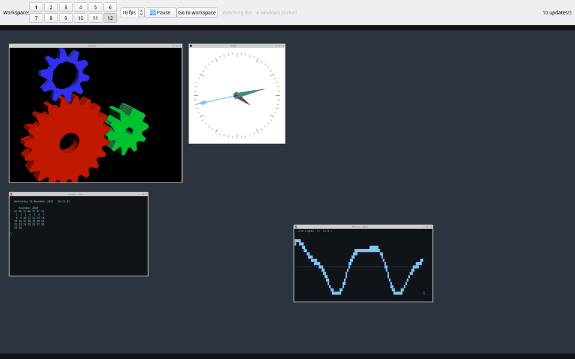
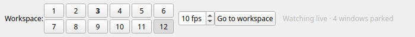

# XFCE Workspace Viewer

Watch the windows on another XFCE workspace **live**, in a window on the workspace you're on.



Leave a build, a simulation, a terminal or a dashboard running on another workspace, then keep an eye on
it from where you're working. The viewer shows every window on the chosen workspace in its real layout,
updating as it changes. It is view-only, so nothing you do in the viewer reaches those windows.

## Features

- Live view of any workspace, with windows drawn at their real positions and in their stacking order.
- Your desktop wallpaper drawn behind the windows.
- Workspace picker: a grid of numbered buttons, two rows of six for 12 workspaces.
- Low CPU use. XDamage means only windows whose contents changed are recaptured, and the capture itself
  uses shared memory (MIT-SHM) and the compositor's off-screen pixmaps.
- Double-click a window in the view to jump to it.
- Safe: every window goes back exactly where it was (workspace, position, size, maximized or fullscreen),
  even if the viewer crashes.



## Requirements

- XFCE 4.16 or later (xfwm4) on **X11**, with the **compositor enabled**: Settings → Window Manager
  Tweaks → Compositor → *Enable display compositing*. This is on by default.
- Python 3 with PyQt5, `wmctrl`, and the X libraries libXcomposite, libXdamage and libXext.

On Debian, Ubuntu or Mint:

```bash
sudo apt install python3-pyqt5 wmctrl libxcomposite1 libxdamage1 libxext6
```

> Not supported: Wayland sessions, and other window managers or desktops such as GNOME, KDE and i3. The
> technique depends on how xfwm4 handles windows on hidden workspaces.

## Install

```bash
git clone https://github.com/fsantibanezc/XFCE_Workspace-viewer.git
cd XFCE_Workspace-viewer
packaging/install.sh
```

The installer checks the dependencies and installs for your user only. It doesn't need `sudo`. It adds:

| What | Where |
| --- | --- |
| Menu entry: **Applications → Accessories → Workspace View** | `~/.local/share/applications/workspace-view.desktop` |
| `workspace-view` command | `~/.local/bin/workspace-view` |
| Application files | `~/.local/share/desktopindesktop/` |
| Icon | `~/.local/share/icons/hicolor/scalable/apps/workspace-view.svg` |

To update, `git pull` and run `packaging/install.sh` again. To remove it, run `packaging/uninstall.sh`.

You can also run it without installing: `python3 wsview.py`.

## Usage

Open **Workspace View** from the applications menu, or run it from a terminal:

```bash
workspace-view                  # watch the first other workspace that has windows
workspace-view --workspace 3    # watch workspace 3
workspace-view --fps 10         # refresh rate, default 5 fps
workspace-view --restore        # put back windows left parked after a crash
```

In the viewer:

| Control | Action |
| --- | --- |
| Number buttons | Pick the workspace to watch. The **pressed** button is the one shown, the **bold** one is where you are, and hovering shows its window count. |
| fps box | Change the refresh rate while it runs. |
| **Go to workspace** | Switch to the workspace you're watching. |
| Double-click a window | Jump to that window. |
| `F` | Toggle fullscreen. |
| `T` | Toggle always on top. |
| `Q` | Quit. |

The status line shows how many windows are parked. The counter on the right shows how many times per
second the view actually redraws; when nothing changes, it doesn't redraw.

## How it works

xfwm4 *unmaps* windows on workspaces you aren't looking at. They stop drawing entirely, so there's
nothing to capture. To watch a workspace, the viewer **parks** its windows:

1. It saves each window's workspace, geometry and state to `~/.cache/desktopindesktop/parked.json`.
2. It moves the window, while it's still hidden, to the bottom-right corner, where xfwm4 leaves only a few
   pixels on screen, under the panel.
3. It makes the window *sticky* (on all workspaces) and hides it from the taskbar and pager, so it stays
   mapped and the compositor keeps rendering it.

The viewer then reads each window's pixels from the compositor's off-screen copy (XComposite plus
MIT-SHM). It draws them scaled at their original positions and only recaptures windows that XDamage
reports as changed.

The windows go back exactly where they were when:

- you close the viewer (close button, `Q`, Ctrl-C or SIGTERM),
- you switch to the watched workspace yourself, so you can use the windows normally, or
- you pick a different workspace in the viewer.

If the viewer is ever killed hard, the saved state lets the next launch, or `workspace-view --restore`, or
the menu entry's right-click action **Restore parked windows**, put everything back.

## Known limitations

- While a workspace is being watched, its windows don't show on that workspace in the taskbar or pager.
  They return as soon as you go there or close the viewer.
- Minimized windows aren't shown, just as they aren't visible on their own workspace.
- When a maximized window is restored, its "un-maximized" size becomes its maximized size.
- Non-rectangular windows such as `xeyes` show their full bounding box.

## Bonus: hidden virtual desktop (`did.py`)

The repo also includes `did.py`. It runs a separate, invisible X display (Xvfb) that you can launch apps
into and watch with its own viewer. Use it when you want apps that never appear on your real desktop at all.

```bash
sudo apt install xvfb && pip install mss
python3 did.py start --wm                 # hidden 1920x1080 desktop on :99
python3 did.py run -- xfce4-terminal      # launch apps into it
python3 did.py view                       # watch it
python3 did.py stop
```

## Project layout

| File | Purpose |
| --- | --- |
| `wsview.py` | Workspace View app: parking, capture loop, Qt UI |
| `x11util.py` | ctypes bindings to libX11, XComposite, MIT-SHM and XDamage |
| `packaging/` | Installer, uninstaller, icon |
| `did.py`, `viewer.py` | Hidden Xvfb desktop and its viewer |
| `docs/` | Screenshots |

## License

MIT. See [LICENSE](LICENSE).
